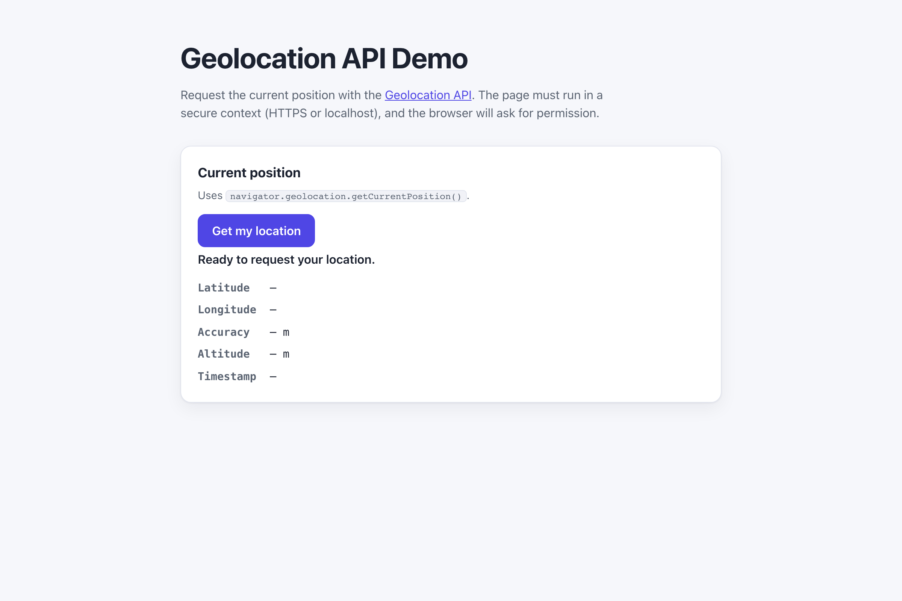

# WebSharper.Geolocation

[](https://github.com/dotnet-websharper/Geolocation)

WebSharper bindings for the [Geolocation API](https://developer.mozilla.org/en-US/docs/Web/API/Geolocation_API) —
reading the user's current position from F# and C# web apps.

The Geolocation API is only available in [secure contexts](https://developer.mozilla.org/en-US/docs/Web/Security/Defenses/Secure_Contexts)
(HTTPS or localhost), and the browser asks for permission before returning a position.

This repository contains:

| Project | Purpose |
| --- | --- |
| `WebSharper.Geolocation` | The binding: WIG definitions for `Geolocation`, `GeolocationPosition`, `GeolocationCoordinates`, `GeolocationPositionError`, `PositionOptions`, and `Navigator`. |
| `WebSharper.Geolocation.Sample` | An ASP.NET Core SPA that requests and displays the current position. |

## Live demos

**Try it live:** [Open the sample in your browser](https://dotnet-websharper.github.io/Geolocation/)



The sample doubles as the binding's test case: it exercises `getCurrentPosition()` with the success and error
callbacks in a real browser.

- **Sample (this repository):** <https://dotnet-websharper.github.io/Geolocation/>
- **Source repository:** <https://github.com/dotnet-websharper/Geolocation>
- **WebSharper bindings:** <https://websharper.com/bindings>

## Features

- `Geolocation.getCurrentPosition()` with success and error callbacks.
- `Geolocation.watchPosition()` and `Geolocation.clearWatch()` for continuous updates.
- `GeolocationPosition` (`coords`, `timestamp`, `toJSON`) and `GeolocationCoordinates` (`latitude`, `longitude`, `accuracy`, `altitude`, `altitudeAccuracy`, `heading`, `speed`).
- `GeolocationPositionError` (`code`, `message`, and the `PERMISSION_DENIED` / `POSITION_UNAVAILABLE` / `TIMEOUT` constants).
- `PositionOptions` (`enableHighAccuracy`, `timeout`, `maximumAge`).

## Installation

The binding is not currently published to NuGet. Reference the projects from source:

```bash
git clone https://github.com/dotnet-websharper/Geolocation.git
```

```xml
<ItemGroup>
  <ProjectReference Include="path/to/WebSharper.Geolocation/WebSharper.Geolocation.fsproj" />
</ItemGroup>
```

## Usage

```fsharp
namespace WebSharper.Geolocation.Demo

open WebSharper
open WebSharper.JavaScript
open WebSharper.Geolocation

[<JavaScript>]
module Demo =
    let geolocation = As<Navigator>(JS.Window.Navigator).Geolocation

    let getLocation () =
        geolocation.GetCurrentPosition(
            (fun position ->
                let coords = position.Coords
                Console.Log($"Latitude: {coords.Latitude}, Longitude: {coords.Longitude}")
            ),
            (fun error ->
                Console.Error($"Geolocation error: {error.Message}")
            )
        )
```

The `Navigator` type in the binding is the `navigator.geolocation` entry point. Cast `JS.Window.Navigator` with
`As<Navigator>` and read the `Geolocation` property.

## Running the sample

Build the sample in Release and serve its static output:

```bash
dotnet build WebSharper.Geolocation.Sample/WebSharper.Geolocation.Sample.fsproj -c Release
python3 -m http.server -d WebSharper.Geolocation.Sample/wwwroot 8099
```

Open <http://localhost:8099/>. Localhost counts as a secure context, so the Geolocation API is available. Grant
the location permission when the browser prompts for it.

Alternatively, run the ASP.NET Core host:

```bash
dotnet run --project WebSharper.Geolocation.Sample
```

## Building from source

### Prerequisites

- [.NET SDK 10](https://dotnet.microsoft.com/download) or later.

### Build

```bash
dotnet build WebSharper.Geolocation.sln -c Release
```

The binding projects target `netstandard2.0`; the sample targets `net10.0`.

## Deployment

Pushing to `main` triggers `.github/workflows/ghpages.yml`, which builds the sample in Release and publishes
`WebSharper.Geolocation.Sample/wwwroot` to the `gh-pages` branch.

## Repository layout

```
WebSharper.Geolocation/              # binding (WIG definitions)
  Main.fs
WebSharper.Geolocation.Sample/       # ASP.NET Core SPA demo
  Client.fs
  Startup.fs
  wwwroot/
    index.html
    site.css
.github/workflows/ghpages.yml        # build + deploy the sample to GitHub Pages
```

## Notes on the API

- **Secure context:** `navigator.geolocation` is only exposed in secure contexts. Serve the page over HTTPS or
  from localhost.
- **Permissions:** the browser asks for permission before returning a position. Handle the error callback and
  `PERMISSION_DENIED`.
- **Accuracy:** `enableHighAccuracy` asks for the best available position; it can be slower and use more power.
- **Watch mode:** `watchPosition()` returns a watch id; pass it to `clearWatch()` to stop receiving updates.

## License

Apache 2.0 — see [LICENSE.md](LICENSE.md).
